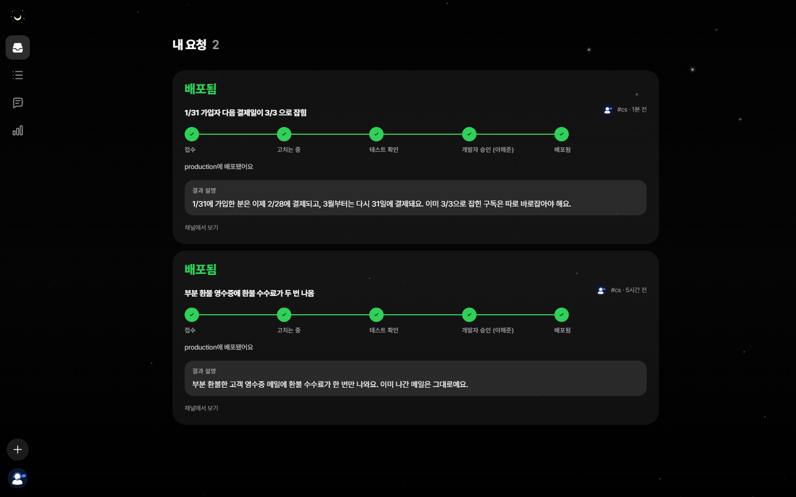
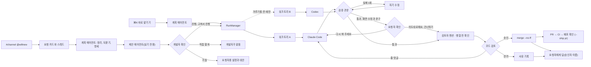

# willnew

비개발자가 팀 채널에 `@willnew` 로 한 줄 남기면, AI 가 빠진 것을 되묻고 작업 명세와 구현 제안("이렇게 개발할까요?")으로 정리합니다. 개발자가 제안을 확인하면 에이전트가 격리된 워크트리에서 작업하고 테스트로 검증합니다. 화면이 바뀌는 요청은 요청자가 미리보기와 전후 스크린샷으로 먼저 확인하고, 그다음 개발자가 코드를 검토해 병합하고 배포까지 추적합니다. 요청자는 승인한 개발자 이름으로 쉬운 말 답을 받습니다. 에이전트는 기본 하나입니다.


## 만든 이유

에이전트에게 일을 시키는 건 이미 쉽습니다. 어려운 건 그 앞뒤입니다. 요청한 사람은 코드를 못 보니 개발자가 몇 px 인지, 어느 화면인지 되물어야 하고, 다 만든 뒤에야 "이게 아닌데요" 가 나오고, 끝나면 요청한 사람에게 다시 설명해야 합니다.

willnew 는 이 앞뒤를 채널 안에서 끝냅니다.

- 요청자는 개발 용어 없이 맡기고, AI 가 묻는 선택지에 답하고, 진행을 "내 요청" 에서 봅니다
- 만들기 전에 개발자가 구현 제안을 보고 진행, 고쳐서 진행, 직접 할게, 거절 중 하나를 고릅니다. 거절 사유는 요청자가 읽을 설명으로 풀어서 돌려줍니다
- 결과는 검증 명령(`npm test` 등)을 통과한 것만 올라옵니다. 테스트 파일을 고쳐서 통과한 결과는 따로 표시하고, 바로 승인하지 않고 검토를 거치게 합니다
- 화면 수정과 문구 요청은 요청자가 미리보기와 전후 스크린샷을 보고 먼저 확인합니다. 개발자는 그 뒤에 diff 와 테스트를 봅니다
- 끝나면 승인한 개발자 이름으로 요청자에게 쉬운 말로 답이 갑니다

## 요청 흐름

```
@willnew 요청 → 정리 → 되묻기 → 작업 명세 → 구현 제안 → 개발자 확인 → 작업과 검증 → 요청자 확인 → 코드 검토 → 병합 → 배포
```

1. 요청자가 채널에 `@willnew 결제 화면 버튼들 좀 답답해 보여요 ㅠ 여백 좀 넉넉하게 해주실 수 있나요?` 처럼 남기면 채널에 요청 카드가 하나 생깁니다. 카드의 한 줄 상태는 단계마다 바뀌고, 그 요청에 관한 답, 멘션, 결정, 확인은 모두 카드의 스레드에 쌓입니다. 스레드 답글은 "채널에도 보내기" 로 채널에 같이 올릴 수 있습니다
2. 정리와 되묻기: 계획 에이전트(Haiku)가 유형(버그, 화면 수정, 문구, 데이터, 기타)과 제목을 정하고, 수용 기준을 세우는 데 빠진 것만 선택지로 묻습니다. 질문은 최대 3개이고 한 번에 하나씩 보이며, 맞는 선택지가 없으면 "기타" 로 직접 적습니다. 고른 답은 요청자 이름의 메시지로 스레드에 남습니다
3. 작업 명세: 문제, 기대 결과, 수용 기준, 범위 밖, 참고 자료를 한 장으로 만듭니다. 요청자 화면에는 쉬운 말 요약, 개발자 화면에는 수용 기준 체크리스트가 보입니다. 메시지에 있는 Figma 링크와 이미지 주소는 첨부로 모아 명세를 쓸 때 같이 넘깁니다. Figma 내용을 읽지는 않습니다
4. 구현 제안: 에이전트가 새로 뗀 워크트리에서 읽기 전용(Claude Code plan 모드, Read, Grep, Glob)으로 저장소를 읽고 "이렇게 개발할까요?" 를 만듭니다. 바꿀 파일, 접근 방법, 위험, 추가할 테스트, 예상 시간과 비용(추정치)이 들어갑니다. 수용 기준에 나온 코드 이름을 요청자도 쓰지 않았고 저장소에서도 찾지 못하면 "확인 필요" 로 표시합니다
5. 개발자 확인: 채널 검토자에게 `@이해준 확인할 제안이 있어요. …` 가 갑니다. 개발자는 넷 중 하나를 고릅니다
   - 진행: 에이전트가 작업을 시작합니다
   - 고쳐서 진행: 적은 문장이 명세의 조건으로 붙고, 조건이 제안보다 우선합니다
   - 직접 할게: AI 작업 없이 그 개발자가 맡습니다
   - 거절: 사유를 적으면 계획 에이전트가 요청자용 설명과 대안으로 풀고, 그 개발자 이름으로 스레드에 답합니다
6. 작업과 검증: 에이전트 하나가 자기 워크트리와 브랜치에서 수용 기준마다 테스트를 먼저 쓰고 코드를 고칩니다. 검증 명령이 실패하면 로그를 돌려주고 한 번 더 고칩니다
7. 요청자 확인: 화면 수정과 문구 요청, 또는 계획 에이전트가 요청자가 봐야 한다고 표시한 요청만 거칩니다. 아래 [요청자 확인](#요청자-확인)
8. 코드 검토: 검토자에게 `@이해준 검토 차례예요. 테스트 7개 통과, main과 충돌 없음` 이 갑니다(숫자는 실제 검증 출력과 병합 전 확인에서 가져오고, 알 수 없으면 그 부분을 뺍니다). 검토자는 승인하거나 반려합니다
9. 병합과 배포: [승인 뒤 반영 방식](#승인-뒤-반영-방식) 그대로입니다
10. 요청자에게 답: 승인한 사람의 이름으로 답이 갑니다(작은 "willnew로 보냄" 표시가 붙습니다). 병합만 추적하면 `@윤서아 반영했어요. 1/31에 가입한 분은 이제 2/28에 결제돼요…`, 배포까지 추적하면 `@윤서아 배포까지 끝났어요. …`, 반려면 `@윤서아 이번엔 반영하지 않았어요. 사유: …`

범위, 우선순위, 승인은 사람이 정합니다. 요청이 제안 단계를 넘어가는 건 개발자의 결정뿐이고, 결정은 모두 결정 기록(누가, 언제, 무엇을, 사유)에 남아 요청 화면 오른쪽에 보입니다.

같은 카드와 스레드 메시지가 역할마다 다른 본문으로 보입니다. 요청자에게는 `만드는 중`, `화면을 확인해 주세요` 같은 쉬운 말, 개발자에게는 `되묻는 중 · 1/2 남음`, `요청자 확인 차례 (한지우)` 같은 상태가 갑니다. 요청자 화면에서도 원문은 접어서 볼 수 있습니다.

"반영했어요" 는 `main` 에 병합했다는 뜻이고, 배포했다고 말하는 것은 `--deploy-check` 로 확인한 뒤뿐입니다.

요청자에게 가는 결과 설명은 에이전트가 씁니다. 작업 지시에 "마지막 줄을 `요청자에게: ` 로 시작해 비개발자가 읽을 한두 문장으로 써라" 가 붙고, willnew 가 그 줄을 떼어 `userNote` 로 저장합니다. 요약에는 이 줄이 남지 않습니다. 에이전트가 줄을 쓰지 않으면 설명 없이 반영 안내만 갑니다.

### 바로 맡기기(옛 흐름)

개발자가 `⌘K` 새로 맡기기나 채널의 `/바로맡기기` 로 보내면 요청 카드 없이 예전처럼 바로 실행합니다. 계획 에이전트가 유형, 지시문, 계획, 검증 명령을 정하고(안 되면 키워드 규칙) 곧장 에이전트가 일하며, 되묻기, 명세, 제안, 요청자 확인은 거치지 않습니다. 접수, 분류, 작업 시작, 결과, 검토자 호출이 채널에 차례로 올라옵니다. 요청자가 `⌘K` 로 보내면 바로 맡기기가 아니라 요청이 됩니다.

## 요청자 확인

통과한 결과가 화면 수정이나 문구 요청이면 코드 검토 전에 요청자 차례가 됩니다. 스레드에 `@한지우 화면을 보고 의도대로인지 알려 주세요` 가 가고, "내 요청" 카드에 "확인해 주세요" 가 뜹니다.

- 미리보기 링크: 에이전트 브랜치와 `main` 을 각각 `--preview` 개발 서버로 띄웁니다. `main` 쪽은 기준 커밋을 따로 뗀 워크트리에서 띄웁니다
- 전후 스크린샷: 같은 화면을 `main`(전)과 브랜치(후)에서 같은 크기로 찍어 나란히, 또는 끌어서 비교합니다. 기본 1440x900 이고, 명세에 모바일이나 휴대폰 이야기가 있으면 390x844 도 찍습니다
- 찍을 화면은 계획 에이전트가 정하고, 없으면 제안의 파일 경로(`pages/`, `routes/`, `app/**/page.tsx` 등)에서 최대 4개를 짐작하고, 그것도 없으면 첫 화면(`/`)입니다. 개발자가 요청 화면에서 고칠 수 있습니다

요청자는 셋 중 하나를 고릅니다.

| 버튼 | 다음 |
|---|---|
| 의도대로예요 | 코드 검토로 넘어가고 검토자를 부릅니다 |
| 다시 봐 주세요 | 스크린샷 위에 상자를 끌어 그리고 상자마다 한 줄 적습니다. 상자는 위치와 함께 명세의 조건이 되고, 같은 에이전트가 같은 브랜치에서 이어서 고칩니다. 다음 통과 결과는 2차 확인으로 다시 요청자에게 옵니다 |
| 건너뛰기(개발자) | 개발자가 이유를 적고 요청자 확인 없이 코드 검토로 넘깁니다. 이유는 결정 기록과 스레드에 남습니다 |

- 스크린샷은 선택 의존성 `playwright-core` 로 찍습니다. 브라우저는 `WILLNEW_SHOTS_BROWSER`(chrome, msedge 또는 실행 파일 경로), Chrome, Edge, `npx playwright install chromium` 이 받아 둔 Chromium 순서로 찾습니다. 없으면 스크린샷 없이 링크만 붙고 그 이유가 카드에 적힙니다
- `--preview` 가 없으면 링크와 스크린샷 없이 확인 단계만 열리고, 개발 서버 명령이 필요하다는 안내가 붙습니다
- 링크 주소는 기본 `http://127.0.0.1:{port}` 라 서버를 띄운 PC 에서만 열립니다. 다른 사람이 열게 하려면 `--preview-base-url "http://my-host:{port}"` 를 줍니다

## 승인 뒤 반영 방식

`serve --ship merge|pr` 로 고릅니다.

| 방식 | 승인하면 |
|---|---|
| `merge`(기본) | 로컬에서 `git merge --no-ff` |
| `pr` | 에이전트 브랜치를 push → `gh pr create` → `gh pr checks` 로 CI 가 끝나길 기다림 → 모두 통과하면 `gh pr merge --squash --delete-branch` |

- PR 본문에는 쉬운 요약, 검증 결과, `요청: <요청자>`, `승인: <승인자>` 가 들어갑니다
- CI 가 하나라도 실패하면 거기서 멈추고, 실패한 검사 이름을 스레드에 올립니다. 자동으로 다시 돌리지 않습니다
- `--deploy-check "<명령>"` 을 주면 병합 뒤 15초마다 그 명령을 돌려 종료 코드 0 이 나올 때까지 기다립니다(최대 30분). `{sha}` 에 병합 커밋이 들어가고, `--deploy-env` 로 환경 이름(기본 `production`)을 바꿉니다. 30분 안에 끝나지 않으면 배포 확인 실패로 남깁니다
- 화면에는 `PR #512 → CI 3/3 → main 병합 → 배포 (production)` 한 줄이 실시간으로 뜹니다. 요청 카드에서는 이 단계가 카드 안에 보이고, 바로 맡긴 일은 단계마다 봇이 채널에 짧은 줄(`PR #512 올렸어요`, `CI 3개 통과`, `main에 병합했어요`, `production 배포 끝났어요`)을 남깁니다

## 에이전트 하나가 기본

기본은 `claude-sonnet` 하나입니다. 겨루기는 바로 맡기기에서 켜야 돌아갑니다.

- 바로 맡기기(`⌘K`)의 "겨루기" 를 켜면 codex 가 둘째로 붙고 "에이전트 2개, 비용도 약 2배" 가 뜹니다
- 채널에서 바로 맡길 때는 메시지에 "겨뤄" 또는 "둘 다" 가 들어 있을 때만 둘이 돕니다. 요청 흐름은 에이전트 하나로만 돕니다
- 겨루기를 켜면 같은 일을 두 에이전트가 따로 풀고, 시간, 비용, 변경 크기를 근거로 통과한 것 중 하나를 추천합니다

겨루기가 결과를 더 낫게 한다는 측정은 아직 없고, 토큰은 두 배로 듭니다. 그래서 기본을 하나로 바꿨습니다.

## 사람과 역할

계정이 없습니다. 설정(왼쪽 아래 아바타)에서 이름, 팀, 직함, 역할을 적으면 이 브라우저에만 저장됩니다.

| 역할 | 첫 화면 | 할 수 있는 것 |
|---|---|---|
| 개발자: 제안 확인, 결과 검토 | 내 차례 | 구현 제안에 진행, 고쳐서 진행, 직접 할게, 거절. 결과에 승인, 고쳐 달라, 반려. 요청자 확인 건너뛰기, 찍을 화면 고치기, 바로 맡기기 |
| 요청자: 맡기고 확인하고 답 받기 | 내 요청 | 맡기기, 되묻기에 답하기, 진행 보기, 결과 화면에 의도대로예요 또는 다시 봐 주세요. 코드 승인 버튼은 없고 "개발자 검토 대기" 로 보입니다 |

- 직함은 자유 표기(`CS`, `디자인`, `백엔드`, `PM`)이고, 채널에서 이름 옆에 작은 표시로 붙습니다
- 프로필 이미지 주소를 적으면 채널, 내 차례, 내 요청, 계정 버튼에 사진이 뜨고, 없으면 이름 끝 두 글자입니다
- 역할은 스스로 고르는 값입니다. 권한을 막는 장치가 아니라 화면을 맞추는 설정입니다
- 채널마다 검토자를 둘 수 있습니다: `serve --reviewers "이해준,정하늘"`. 요청자가 아닌 첫 사람이 제안 확인과 코드 검토에 멘션되고, 없으면 멘션 없이 올라옵니다. 내 이름이 멘션되면 채널에서 강조되고, 스레드마다 안 읽음과 나를 부른 표시가 붙습니다

## 내 차례와 내 요청

개발자 첫 화면 "내 차례" 에는 확인할 제안이 맨 위에, 그 아래 검토할 결과(보름달)가 올라옵니다.

"내 요청"(`#/mine`)은 내가 맡긴 일을 카드로 보여 줍니다. 요청 흐름으로 들어온 것은 네 단계 이해 → 합의 → 작업 → 반영으로 묶어 보이고, 지금 하위 단계(되묻기, 제안, 화면 확인, 검토 등)는 옆에 낱말 하나로 씁니다. 화면 확인 차례인 카드에는 "확인해 주세요" 가 뜨고, 되묻기에 답하거나 화면을 확인할 요청 수가 "내 요청" 메뉴에 숫자로 붙습니다. 거절되면 쉬운 말로 푼 사유와 대안이 붙고, 끝나면 에이전트가 남긴 쉬운 설명과 "채널에서 보기" 링크가 있습니다. 바로 맡긴 일은 예전 카드(접수 → 고치는 중 → 테스트 확인 → 개발자 승인 → 반영됨)로 보입니다. diff, 터미널, 에이전트 로그는 이 화면에 없고, 휴대폰 폭에서는 단계가 세로로 쌓입니다.

## 달

맡긴 일은 달처럼 차오릅니다. 보름달이 뜨면 사람 차례입니다.

| | 단계 |
|---|---|
| 삭 → 초승 | 읽는 중 → 계획 |
| 반달 | 에이전트가 일하는 중 |
| 볼록 | 검증 중(실패하면 한 번 다시) |
| 보름 | 내 차례, 통과한 결과와 추천 |
| 흐린 보름, 그믐 | 병합, 반려 |

요청 카드의 네 단계도 칸마다 달이 차오르는 모양으로 진행을 보여 줍니다.

## 혼자 쓰는 에이전트 도구와 다른 점

에이전트를 워크트리에서 돌리고 지켜보는 도구는 이미 있습니다. willnew 는 그 앞에 요청을 정리하고 합의하는 단계를, 뒤에 검증과 양쪽 확인, 요청자 답변을 얹었습니다.

| | |
|---|---|
| 만들기 전 합의 | 되묻기, 작업 명세, 구현 제안을 거쳐 개발자가 확인한 뒤에만 에이전트가 작업합니다. 결정은 결정 기록에 남습니다 |
| 역할별 본문 | 같은 카드와 메시지를 요청자에게는 쉬운 말로, 개발자에게는 명세와 상태로 보여 줍니다 |
| 검증 관문 | 결과마다 검증 명령을 돌려 통과한 것만 올립니다. 테스트 파일을 고쳐서 통과한 결과는 따로 표시하고 추천에서 뒤로 뺍니다. 병합 전에 `main` 과 충돌하는지도 미리 봅니다 |
| 요청자 확인 | 화면이 바뀌는 결과는 요청자가 미리보기와 전후 스크린샷으로 먼저 보고, 다시 봐 달라고 표시한 곳은 다음 시도의 조건이 됩니다 |
| 병합 이후 | `--ship pr` 이면 PR → CI → 병합 → 배포 확인을 이어서 하고, 끝나면 승인자 이름으로 요청자에게 답합니다 |
| 팀 창구와 지표 | 팀 채널의 요청 카드와 스레드에서 답하고 결정합니다. 팀, 템플릿, 에이전트별 자동 해결률, 승인율, 비용, 예산을 봅니다 |
| IDE 기본기 | 에이전트 칸마다 실제 터미널, 변경, 미리보기, 일하는 중에도 이어서 지시, 줄 댓글을 모아 다시 맡기기, 단축키 |

## 실행과 검토

- 맡기기: 요청은 채널에 `@willnew …`, 또는 요청자의 `⌘K`. 개발자의 `⌘K` 는 바로 맡기기
- 실행: 기본은 Claude Code 하나가 자기 워크트리와 브랜치에서. 바로 맡기기에서 겨루기를 켜면 Codex 가 따로 하나 더. 칸마다 진행, 터미널, 변경, 미리보기
- 이어서 지시: 일하는 중에 보내면 지금 턴을 멈추고 같은 세션으로 이어서 반영(Claude `--resume`, Codex `exec resume`). 끝난 뒤에 보내면 다시 열어 고치고 검증 관문을 다시 지납니다. 요청자의 "다시 봐 주세요" 도 이 경로로 같은 에이전트에게 갑니다
- 검증 관문: 검증 명령의 종료 코드가 판정. 실패하면 로그를 돌려주고 1회 자기 수정
- 검토와 승인: 파일마다 검토함 체크, 줄 댓글 → 에이전트에게 다시 맡기기, 병합 전 확인(검증, 테스트 파일, 충돌, 검토 진행), 승인(`git merge --no-ff`) 또는 사유를 남긴 반려. 휴대폰에서는 밀어서 승인
- 지표: 팀, 템플릿, 에이전트별 자동 해결률, 승인율, 시간, 비용, 절약 시간(가정치), 예산

## 화면

아래 스크린샷과 GIF 는 B1 이전(2026-10-14)에 찍었습니다. 채널과 내 요청은 지금의 바로 맡기기 흐름과 같은 모습이고, 요청 카드, 구현 제안, 요청자 확인 화면은 아직 스크린샷이 없습니다. 이 화면들은 데모 `/?demo&as=한지우` 에서 볼 수 있습니다.


| 내 차례: 보름달이 뜬 결과 | 채널: 바로 맡긴 일의 검토자 호출, PR → CI → 배포, 요청자 답장 |
|---|---|
|  |  |
| 내 요청: 바로 맡긴 일의 카드 | 새로 맡기기(⌘K): 계획 한 줄, 겨루기 토글 |
|  |  |
| 작업 공간: 실패 → 재작업 → 통과, 테스트 파일 고침 표시 | 검토: 줄 댓글, 결과 비교(겨루기를 켠 기록) |
|  |  |
| 지표: 데모 데이터 | |
|  | |


스크린샷과 GIF 는 서버 없이 도는 데모 모드(`/?demo`)에 개인 테마를 입혀 찍었습니다. 저장소에는 중립 기본 테마가 들어 있습니다([테마](#테마)). GIF 는 [포트폴리오](https://haejyn.github.io/tving/#willnew)의 소개 영상을 줄인 것입니다. 인물은 모두 가상입니다.

데모에서 사람을 바꿔 보려면 `/?demo&as=한지우` (요청자, 디자인), `/?demo&as=윤서아` (요청자, CS), `/?demo&as=이해준` (개발자)으로 열거나, 설정의 "보는 사람" 을 누릅니다. 한지우의 결제 화면 요청은 되묻기 → 제안 → 고쳐서 진행 → 미리보기 전후 쌍 → 다시 봐 주세요 → 두 번째 시도 → 의도대로예요 → 코드 검토 → 배포까지 이어집니다. 데모 상태는 새로고침하면 처음으로 돌아갑니다. 데모의 승인은 `pr` 모드를 흉내 냅니다(PR #512, 검사 세 개, 병합, 배포 약 4초). 실제 `gh` 는 부르지 않습니다.

## 실측

예제 저장소 `examples/duration`, 테스트 7개 전부 실패 상태에서 시작. B1 이전, 겨루기가 기본이던 때의 바로 맡기기 기록이라 첫 줄은 에이전트 둘입니다.

| 채널 | 계획 | 실행 | 결과 |
|---|---|---|---|
| `#backend` 버그 수정 | 24.8 s · $0.02 | sonnet 19 s $0.10 · codex 45 s | 둘 다 1차 통과, sonnet 승인 후 병합 |
| `#data` 테스트 작성 | 15.5 s · $0.02 | sonnet 37 s $0.20 | 1차 실패, 자기 수정 후 통과, 승인 |
| `#content-ops` 문서화 | 23.1 s · $0.02 | sonnet 33 s $0.19 | 1차 실패, 자기 수정 후에도 실패, 반려 |

- 요청 3건 · 자동 해결 67 % · 승인율 67 % · 총 $0.55
- 절약 시간은 템플릿별 가정치 × 승인 건, 측정값 아님
- 환경: Windows 11 · Claude Code 2.1 · Codex CLI 0.151 · 2026-09-30

## 실행

```bash
pnpm install && pnpm build
node scripts/demo-repo.mjs ../willnew-demo
node dist/server/cli.js serve --repo ../willnew-demo --check "npm test" --reviewers "이해준,정하늘" --ship merge --preview "npm run dev -- --port {port}"
```

- 주소 `http://127.0.0.1:7777`. `#backend` 에서 `@willnew duration 테스트 실패` 로 요청을 남기거나, 개발자로 `⌘K` 바로 맡기기
- `--reviewers` 는 채널 검토자 이름(쉼표로 구분). 안 주면 멘션 없이 올라옵니다
- `--ship pr` 은 `git` 의 `origin` 과 로그인된 `gh` 가 필요합니다
- `--preview` 는 에이전트 워크트리마다 띄울 개발 서버 명령. `{port}` 와 `PORT` 에 빈 포트가 들어가 서로 겹치지 않습니다. 요청자 확인의 미리보기와 스크린샷도 이 명령으로 띄웁니다
- `--preview-base-url "http://my-host:{port}"` 는 다른 사람이 여는 미리보기 주소. `{port}` 가 꼭 들어가야 합니다
- 전후 스크린샷을 쓰려면 `playwright-core` 가 있어야 합니다. 선택 의존성이라 설치에 실패해도 나머지는 돌고, 없으면 `pnpm add -O playwright-core`
- 서버 없이 화면만 보려면 `/?demo`
- 필요: Node 20+, git, `claude` 또는 `codex` 로그인. 정리, 되묻기, 명세, 제안은 Claude Code 로 돕니다
- 외부 접속 `--host 0.0.0.0` 은 토큰 필수(터미널이 열리므로)

## 단축키

| 키 | 동작 |
|---|---|
| `⌘K` · `⌘N` | 새로 맡기기 · 기존 요청 검색 |
| `?` | 단축키 보기 |
| `⌘1` `⌘2` … | 에이전트 칸으로 이동해 지시 입력 |
| `↵` | 지시 보내기 |
| `J` `K` · `C` | 검토에서 다음 · 이전 파일, 줄 댓글 |
| `⌘↵` · `R` | 승인하고 병합 · 반려 |

## 구조



| 파일 | 역할 |
|---|---|
| `src/server/requests.ts` | 요청: 정리, 되묻기, 명세, 제안, 개발자 결정, 실행 연결, 요청자 확인, 결정 기록 |
| `src/server/request-state.ts` | 요청 상태와 이동, 요청자 확인으로 갈지, 상자를 조건과 후속 지시로, 카드 본문(웹과 데모도 같이 씀) |
| `src/server/brief.ts` · `prompts.ts` | 계획 에이전트(Haiku)의 정리, 되묻기, 명세, 거절 설명. JSON 검증과 1회 재시도, 안 되면 최소 결과 |
| `src/server/proposal.ts` · `spec-check.ts` | 읽기 전용 구현 제안, 저장소에서 못 찾은 이름에 확인 필요 표시 |
| `src/server/visual.ts` · `shots.ts` | 브랜치와 `main` 미리보기, 전후 스크린샷(`playwright-core`) |
| `src/server/triage.ts` | 바로 맡기기의 계획 에이전트 |
| `src/server/runs.ts` | 워크트리, 실행, 이어서 지시, 검증, 자기 수정, 줄 댓글, 미리보기, 병합 전 확인, 승인 |
| `src/server/ship.ts` | PR → CI 대기 → 병합 → 배포 추적(명령 실행기를 주입해 테스트) |
| `src/server/handoff.ts` | 검토자 고르기, 멘션 문장, 요청자 답 문장, `요청자에게:` 줄 파서 |
| `src/server/chat.ts` · `threads.ts` | 채널 창구, 요청 카드와 스레드, 스레드 요약과 멘션 규칙 |
| `src/server/terminal.ts` | 워크트리 셸(PTY, 웹소켓) |
| `src/server/adapters.ts` | Claude Code · Codex · 오프라인 script 어댑터(세션 이어가기 포함) |
| `src/server/git.ts` | 워크트리, diff, 테스트 파일 판별, 충돌 미리 보기(`merge-tree`) |
| `src/server/metrics.ts` · `templates.ts` | 지표, 업무 템플릿(기본 에이전트 하나), 팀, 예산 |
| `web/` | React UI: 내 요청, 내 차례, 요청 화면, 요청자 확인, 작업 공간, 검토, 채널과 스레드, 지표, 휴대폰. 터미널은 xterm.js |

## 테마

저장소에는 중립 기본 테마(`web/src/theme/public/`: 중립 색, 시스템 서체, Lucide 아이콘)만 들어 있습니다. 같은 변수 이름으로 `theme.css` 와 `icons.ts` 를 담은 폴더를 만들고 `WILLNEW_THEME_DIR` 로 가리키면 그 테마로 빌드됩니다. 스크린샷의 모습은 저장소에 없는 개인 테마입니다.

```bash
WILLNEW_THEME_DIR=../my-theme pnpm build
```

## 개발

```bash
pnpm test        # 95개: 오프라인 에이전트, 가짜 계획 에이전트, 가짜 gh, 가짜 스크린샷 도구로 실행
pnpm typecheck   # 서버 + 웹
```

테스트는 실행, 이어서 지시, 줄 댓글, 검증 관문, 충돌, 미리보기, 웹소켓 터미널, PR → CI → 배포, 요청 상태와 이동, 계획 JSON 검증과 재시도, 되묻기, 네 가지 결정, 요청자 확인(표시에서 후속 시도까지, 건너뛰기), 스레드 분리와 옛 메시지 옮기기를 다룹니다.

## 제한

- 사용자 계정이 없습니다. 이름, 역할, 직함은 각자 설정에서 고르고 브라우저에만 저장됩니다. 요청자 역할이어도 URL 로 검토 화면에 들어가 읽을 수 있고, 역할이 권한을 막지는 않습니다
- 정리, 되묻기, 명세, 제안은 Claude Code 가 없거나 `WILLNEW_TRIAGE=rules` 이면 규칙으로 만든 최소 결과로 대신하고, 카드에 그렇게 표시합니다. 계획 에이전트 응답이 두 번 검증에 실패해도 같습니다
- 구현 제안의 예상 시간과 비용은 추정치입니다
- Figma 링크는 첨부로 넘기기만 하고, 디자인 값을 읽지는 않습니다
- 미리보기와 스크린샷은 `--preview` 개발 서버가 있어야 하고, 스크린샷은 `playwright-core` 와 브라우저가 있어야 합니다. 찍을 화면 짐작은 파일 경로 규칙이라 틀릴 수 있어 개발자가 고칠 수 있게 했습니다
- `pr` 모드는 가짜 `gh` 와 가짜 배포 명령으로만 테스트했습니다. 실제 GitHub 에 대해서는 돌려 보지 않았고, 로컬 bare 저장소로는 `git push` 까지만 확인할 수 있어 `gh` 는 검증되지 않습니다. 저장소에 `origin` 이 없거나 `gh` 로그인이 안 되어 있으면 PR 을 올리지 못했다고 알리고 멈춥니다
- 승인은 CI 결과와 무관하게 기록됩니다. CI 가 실패하면 승인됨 상태로 남지만 병합되지 않고, 다시 올리는 버튼은 아직 없습니다
- 채널 검토자는 서버를 띄울 때 `--reviewers` 로 한 번 정합니다. 웹에서 바꾸는 화면은 없습니다
- "요청자에게" 설명은 에이전트가 쓴 문장이고 틀릴 수 있습니다. 승인하는 개발자가 변경과 함께 읽는 것을 전제로 합니다
- "반영했어요" 는 `main` 병합까지입니다. 배포는 `--deploy-check` 를 준 경우에만 확인하고, 없으면 알지 못합니다
- 겨루기가 더 낫다는 근거는 없습니다. 데모와 실측 표의 겨루기 기록은 비교용 예시입니다
- 이어서 지시와 줄 댓글 다시 맡기기는 오프라인 에이전트로 검증했습니다. 실제 Claude Code(`--resume`)와 Codex(`exec resume`) CLI 로는 아직 돌려 보지 않았습니다
- `요청자에게:` 줄 지시도 실제 CLI 로는 아직 확인하지 않았고, 파서는 단위 테스트로만 검증했습니다
- 터미널은 `@lydell/node-pty` 가 있으면 진짜 PTY, 없으면 줄 편집 없는 간이 셸
- Codex 는 Windows 에서 `danger-full-access`, 워크트리로 격리. Codex 비용 미보고
- 승인한 뒤에도 워크트리는 남고, 실행을 지울 때 함께 지워집니다
- 에이전트는 서버를 띄운 PC 의 Claude, Codex 로그인으로 돕니다. 한 사람의 구독으로 팀원 요청을 처리하는 것은 Anthropic 이용 조건에 맞지 않으므로, 지금은 혼자 또는 각자 자기 서버로 쓰는 용도입니다
- 계획: 구현 제안을 확인한 개발자의 PC 에서 그 사람의 로그인으로 돌리는 러너, Slack 앱 연동, Figma 디자인 값 읽기([설계](docs/design/bridge.md)). 동시 실행 한도와 원격 실행기도 아직 없습니다

코드는 MIT. 이름, 로고, 스크린샷 속 개인 테마는 라이선스에 포함되지 않아요([NOTICE](NOTICE)).
