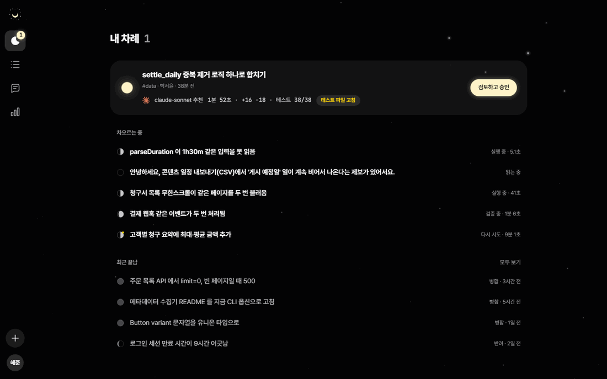
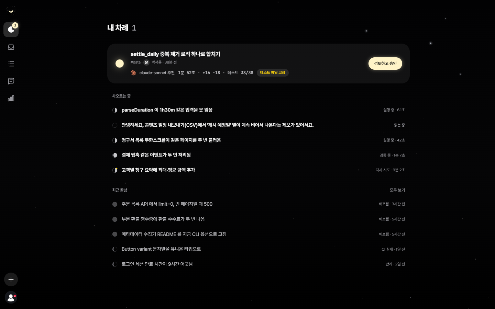
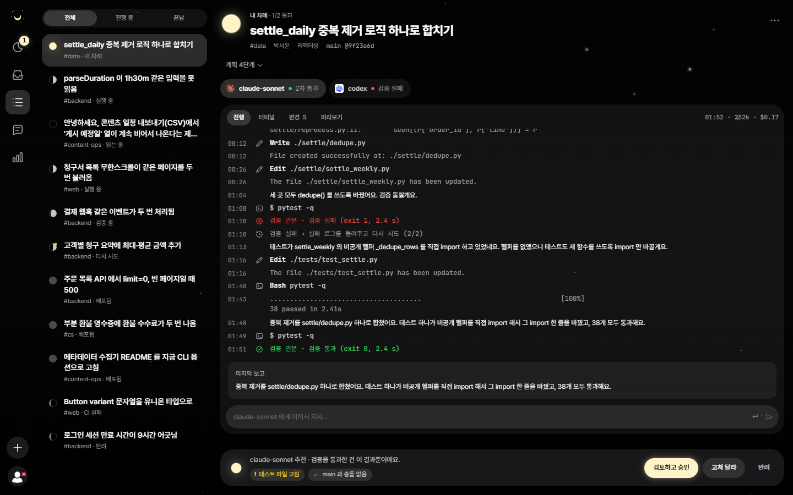
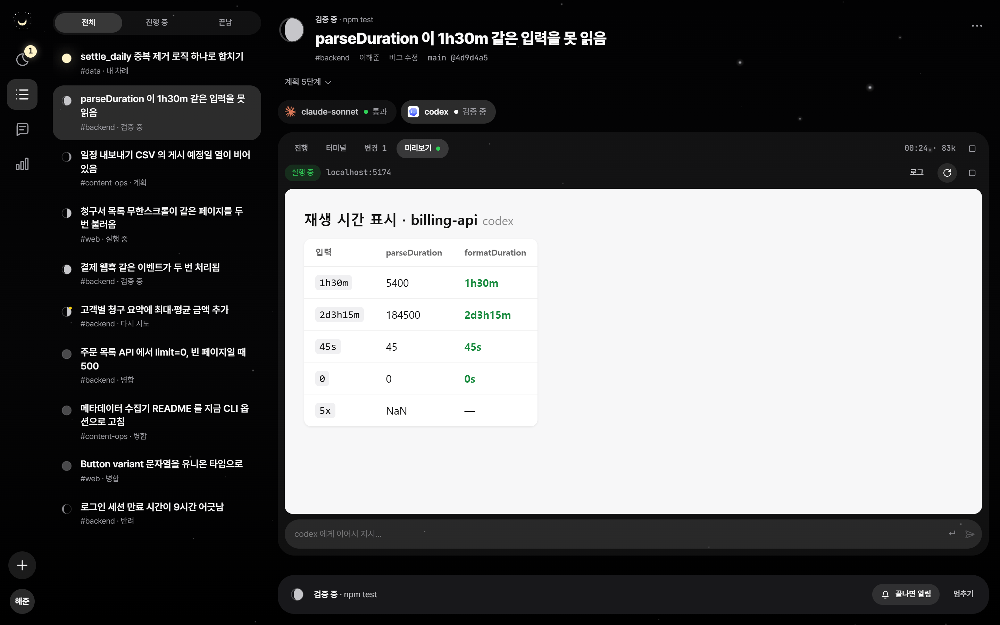
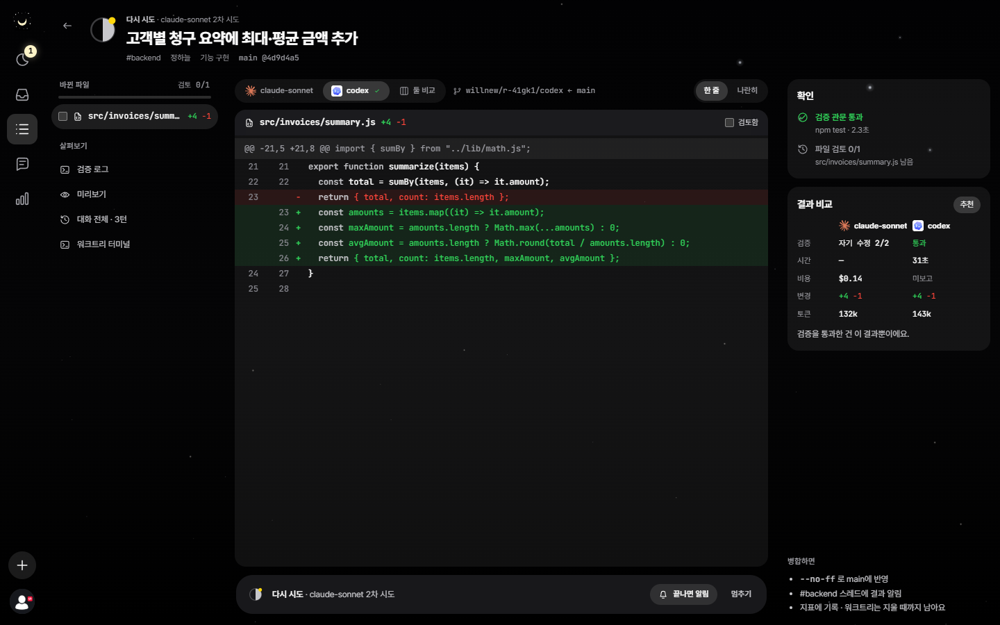
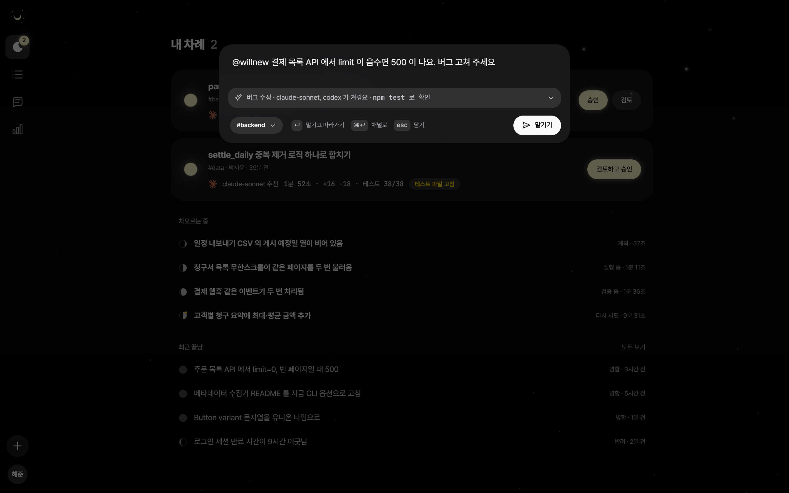
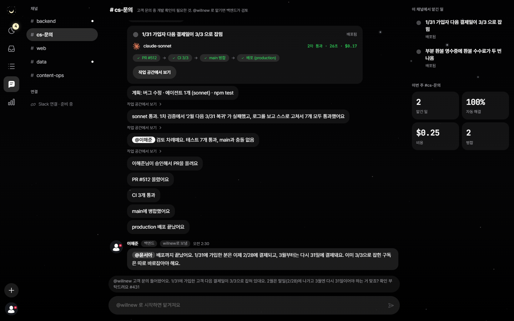
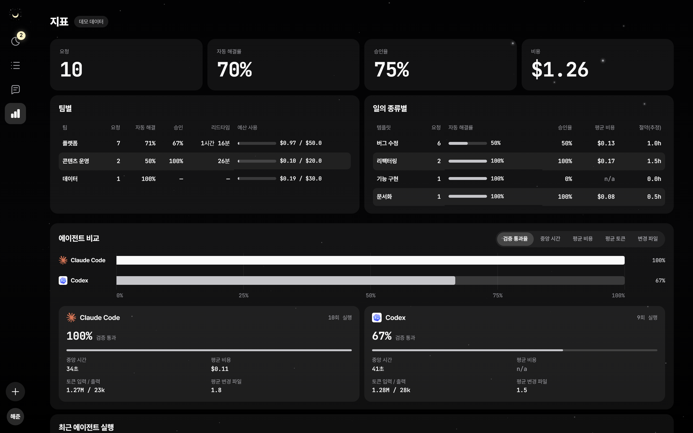
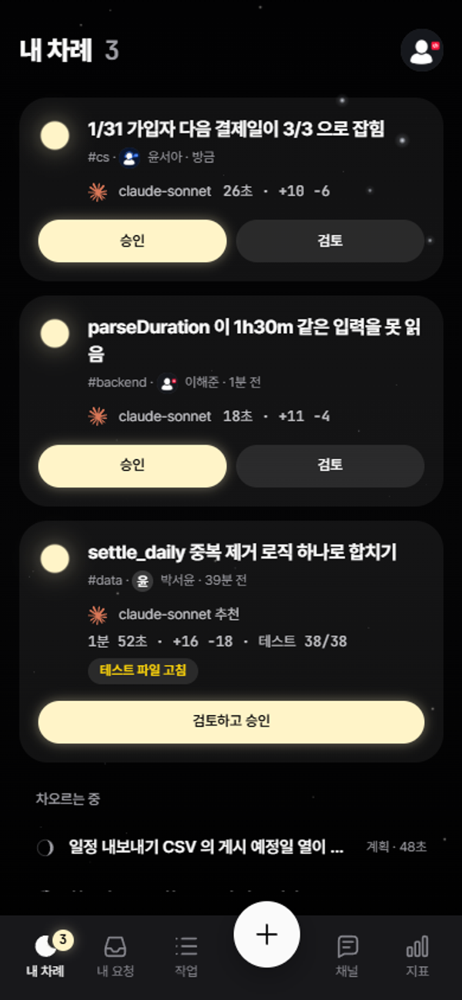
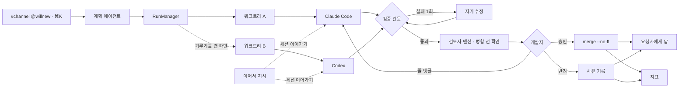

# willnew

고객 문의를 받은 비개발자가 팀 채널에 `@willnew` 로 한 줄 남기면, AI 에이전트가 고치고, willnew 가 테스트로 확인하고, 담당 개발자는 승인만 하고, 요청자는 쉬운 말로 된 답을 받습니다. 에이전트는 기본 하나이고, 둘을 겨루게 하는 건 선택입니다.




## 만든 이유

에이전트에게 일을 시키는 건 이미 쉽습니다. 어려운 건 그 앞뒤입니다. 문의를 받은 사람은 코드를 못 보니 개발자에게 옮겨 적어야 하고, 개발자는 결과가 정말 되는지 직접 열어 확인해야 하고, 끝나면 문의한 사람에게 다시 설명해야 합니다.

willnew 는 이 앞뒤를 채널 안에서 끝냅니다.

- 요청자는 개발 용어 없이 맡기고, 진행을 "내 요청" 에서 봅니다
- 결과는 검증 명령(`npm test` 등)을 통과한 것만 개발자에게 올라옵니다. 테스트 파일을 고쳐서 통과한 결과는 따로 표시하고, 바로 승인하지 않고 검토를 거치게 합니다
- 개발자는 승인 · 고쳐 달라 · 반려 중 하나만 고릅니다. 승인하면 `main` 에 병합합니다
- 승인이나 반려가 나면 봇이 요청자에게 쉬운 말로 답합니다

## 팀이 일하는 순서

1. 요청자(예: CS)가 채널에 문의를 옮겨 적고 `@willnew` 로 맡깁니다
2. 에이전트 하나가 격리된 git 워크트리에서 고치고 검증 명령을 돌립니다. 실패하면 로그를 돌려주고 한 번 더 고칩니다
3. 통과하면 봇이 스레드에서 검토자를 부릅니다. `@이해준 검토 차례예요. 테스트 7개 통과, main과 충돌 없음` (숫자는 실제 검증 출력과 병합 전 확인에서 가져오고, 알 수 없으면 그 부분을 뺍니다)
4. 검토자는 변경을 보고 승인하거나 반려합니다. 채널 카드와 검토 화면 어디서든 됩니다
5. 봇이 요청자에게 답합니다. 승인이면 `@윤서아 반영했어요. 1/31에 가입한 분은 이제 2/28에 결제돼요… (승인: 이해준)`, 반려면 `@윤서아 이번엔 반영하지 않았어요. 사유: …`

"반영했어요" 는 `main` 에 병합했다는 뜻입니다. 배포했다는 말은 하지 않습니다.

요청자에게 가는 설명은 에이전트가 씁니다. 작업 지시에 "마지막 줄을 `요청자에게: ` 로 시작해 비개발자가 읽을 한두 문장으로 써라" 가 붙고, willnew 가 그 줄을 떼어 `userNote` 로 저장합니다. 요약에는 이 줄이 남지 않습니다. 에이전트가 줄을 쓰지 않으면 설명 없이 반영 안내만 갑니다.

## 에이전트 하나가 기본

기본은 `claude-sonnet` 하나입니다. 겨루기는 켜야 돌아갑니다.

- 새로 맡기기(`⌘K`)의 "겨루기" 를 켜면 codex 가 둘째로 붙고 "에이전트 2개, 비용도 약 2배" 가 뜹니다
- 채널에서는 메시지에 "겨뤄" 또는 "둘 다" 가 들어 있을 때만 둘이 돕니다
- 겨루기를 켜면 같은 일을 두 에이전트가 따로 풀고, 시간 · 비용 · 변경 크기를 근거로 통과한 것 중 하나를 추천합니다

겨루기가 결과를 더 낫게 한다는 측정은 아직 없고, 토큰은 두 배로 듭니다. 그래서 기본을 하나로 바꿨습니다.

## 사람과 역할

계정이 없습니다. 설정(왼쪽 아래 아바타)에서 이름 · 팀 · 직함 · 역할을 적으면 이 브라우저에만 저장됩니다.

| 역할 | 첫 화면 | 할 수 있는 것 |
|---|---|---|
| 개발자: 검토하고 승인 | 내 차례 | 변경 읽기, 승인, 고쳐 달라, 반려 |
| 요청자: 맡기고 결과 받기 | 내 요청 | 맡기기, 진행 보기, 읽기. 승인 버튼은 없고 "개발자 검토 대기" 로 보입니다 |

- 직함은 자유 표기(`CS`, `백엔드`, `PM`)이고, 채널에서 이름 옆에 작은 표시로 붙습니다
- 역할은 스스로 고르는 값입니다. 권한을 막는 장치가 아니라 화면을 맞추는 설정입니다
- 채널마다 검토자를 둘 수 있습니다: `serve --reviewers "이해준,정하늘"`. 요청자가 아닌 첫 사람이 멘션되고, 없으면 멘션 없이 올라옵니다. 내 이름이 멘션되면 채널에서 강조됩니다

## 내 요청

`#/mine`. 내가 맡긴 일을 카드로 보여 줍니다.

접수 → 고치는 중 → 테스트 확인 → 개발자 검토 대기(검토자 이름) → 반영됨. 반려되면 마지막 칸이 "반영 안 함" 으로 바뀌고 사유가 붙습니다. 지금 단계에 달 모양 아이콘이 뜨고, 에이전트가 남긴 쉬운 설명과 "채널에서 보기" 링크가 있습니다. diff, 터미널, 에이전트 로그는 이 화면에 없고, 휴대폰 폭에서는 단계가 세로로 쌓입니다.

## 달

맡긴 일은 달처럼 차오릅니다. 보름달이 뜨면 사람 차례입니다.

| | 단계 |
|---|---|
| 삭 → 초승 | 읽는 중 → 계획 |
| 반달 | 에이전트가 일하는 중 |
| 볼록 | 검증 중(실패하면 한 번 다시) |
| 보름 | 내 차례, 통과한 결과와 추천 |
| 흐린 보름 · 그믐 | 병합 · 반려 |

개발자 첫 화면 "내 차례" 에는 보름달만 올라옵니다.

## 혼자 쓰는 에이전트 도구와 다른 점

에이전트를 워크트리에서 돌리고 지켜보는 도구는 이미 있습니다. willnew 는 그 위에 팀이 맡기고, 검증된 결과만 사람이 받고, 요청자가 답을 받는 흐름을 얹었습니다.

| | |
|---|---|
| 검증 관문 | 결과마다 검증 명령을 돌려 통과한 것만 승인으로 올립니다. 테스트 파일을 고쳐서 통과한 결과는 따로 표시하고 추천에서 뒤로 뺍니다. 병합 전에 `main` 과 충돌하는지도 미리 봅니다 |
| 요청자 답변 | 승인 · 반려가 나면 요청자에게 쉬운 말로 답이 가고, "내 요청" 에서 진행을 봅니다 |
| 팀 창구와 지표 | 팀 채널에서 `@willnew` 로 맡기고 채널에서 바로 승인 · 반려합니다. 팀 · 템플릿 · 에이전트별 자동 해결률 · 승인율 · 비용 · 예산을 봅니다 |
| IDE 기본기 | 에이전트 칸마다 실제 터미널 · 변경 · 미리보기, 일하는 중에도 이어서 지시, 줄 댓글을 모아 다시 맡기기, 단축키 |

## 흐름

- 맡기기: 채널에 `@willnew 버그 수정: …`, 또는 어디서든 `⌘K`. 계획 에이전트(Haiku)가 유형 · 지시문 · 계획 · 검증 명령을 정하고, 안 되면 키워드 규칙
- 실행: 기본은 Claude Code 하나가 워크트리 · 브랜치에서. 겨루기를 켜면 Codex 가 따로 하나 더. 칸마다 진행 · 터미널 · 변경 · 미리보기
- 이어서 지시: 일하는 중에 보내면 지금 턴을 멈추고 같은 세션으로 이어서 반영(Claude `--resume`, Codex `exec resume`). 끝난 뒤에 보내면 다시 열어 고치고 검증 관문을 다시 지납니다
- 검증 관문: 검증 명령의 종료 코드가 판정. 실패하면 로그를 돌려주고 1회 자기 수정
- 검토 · 승인: 파일마다 검토함 체크, 줄 댓글 → 에이전트에게 다시 맡기기, 병합 전 확인(검증 · 테스트 파일 · 충돌 · 검토 진행), 승인(`git merge --no-ff`) 또는 사유를 남긴 반려. 휴대폰에서는 밀어서 승인
- 지표: 팀 · 템플릿 · 에이전트별 자동 해결률, 승인율, 시간, 비용, 절약 시간(가정치), 예산

## 화면

| 내 차례: 보름달만 올라와요 | 작업 공간: 차오르는 중, 자기 수정 |
|---|---|
|  |  |
| 에이전트 칸: 결과를 띄워 직접 눌러 보기 | 검토 · 승인: 줄 댓글, 결정 바 |
|  |  |
| 새로 맡기기(⌘K): 계획 한 줄 미리보기 | 팀 채널 |
|  |  |
| 지표: 데모 데이터 | |
|  | |



스크린샷과 GIF 는 서버 없이 도는 데모 모드(`/?demo`)에 개인 테마를 입혀 찍었습니다. 저장소에는 중립 기본 테마가 들어 있습니다([테마](#테마)). 이 이미지들은 겨루기가 기본이던 때의 화면이라 에이전트가 둘로 나옵니다. "내 요청" 과 역할 설정 화면은 아직 새로 찍지 않았습니다.

데모에서 사람을 바꿔 보려면 `/?demo&as=윤서아` (요청자, CS) 또는 `/?demo&as=이해준` (개발자)으로 열거나, 설정의 "보는 사람" 을 누릅니다. 데모 상태는 새로고침하면 처음으로 돌아갑니다.

## 실측

예제 저장소 `examples/duration`, 테스트 7개 전부 실패 상태에서 시작. 겨루기가 기본이던 때의 기록이라 첫 줄은 에이전트 둘입니다.

| 채널 | 계획 | 실행 | 결과 |
|---|---|---|---|
| `#backend` 버그 수정 | 24.8 s · $0.02 | sonnet 19 s $0.10 · codex 45 s | 둘 다 1차 통과, sonnet 승인 후 병합 |
| `#data` 테스트 작성 | 15.5 s · $0.02 | sonnet 37 s $0.20 | 1차 실패, 자기 수정 후 통과, 승인 |
| `#content-ops` 문서화 | 23.1 s · $0.02 | sonnet 33 s $0.19 | 1차 실패, 자기 수정 후에도 실패, 반려 |

- 요청 3건 · 자동 해결 67 % · 승인율 67 % · 총 $0.55
- 절약 시간은 템플릿별 가정치 × 승인 건, 측정값 아님
- 환경: Windows 11 · Claude Code 2.1 · Codex CLI 0.151 · 2026-09-30

## 실행

```bash
pnpm install && pnpm build
node scripts/demo-repo.mjs ../willnew-demo
node dist/server/cli.js serve --repo ../willnew-demo --check "npm test" --reviewers "이해준,정하늘" --preview "npm run dev -- --port {port}"
```

- 주소 `http://127.0.0.1:7777`. `⌘K` 로 맡기거나 `#backend` 에서 `@willnew duration 테스트 실패`
- `--reviewers` 는 채널 검토자 이름(쉼표로 구분). 안 주면 멘션 없이 올라옵니다
- `--preview` 는 에이전트 워크트리마다 띄울 개발 서버 명령. `{port}` 와 `PORT` 에 빈 포트가 들어가 서로 겹치지 않습니다
- 서버 없이 화면만 보려면 `/?demo`
- 필요: Node 20+, git, `claude` 또는 `codex` 로그인
- 외부 접속 `--host 0.0.0.0` 은 토큰 필수(터미널이 열리므로)

## 단축키

| 키 | 동작 |
|---|---|
| `⌘K` · `⌘N` | 새로 맡기기 · 기존 요청 검색 |
| `?` | 단축키 보기 |
| `⌘1` `⌘2` … | 에이전트 칸으로 이동해 지시 입력 |
| `↵` | 지시 보내기 |
| `J` `K` · `C` | 검토에서 다음 · 이전 파일, 줄 댓글 |
| `⌘↵` · `R` | 승인하고 병합 · 반려 |

## 구조



| 파일 | 역할 |
|---|---|
| `src/server/triage.ts` | 계획 에이전트 |
| `src/server/runs.ts` | 워크트리 · 실행 · 이어서 지시 · 검증 · 자기 수정 · 줄 댓글 · 미리보기 · 병합 전 확인 · 승인 |
| `src/server/handoff.ts` | 검토자 고르기 · 멘션 문장 · 요청자 답 문장 · `요청자에게:` 줄 파서 |
| `src/server/terminal.ts` | 워크트리 셸(PTY, 웹소켓) |
| `src/server/adapters.ts` | Claude Code · Codex · 오프라인 script 어댑터(세션 이어가기 포함) |
| `src/server/git.ts` | 워크트리 · diff · 테스트 파일 판별 · 충돌 미리 보기(`merge-tree`) |
| `src/server/chat.ts` · `metrics.ts` · `templates.ts` | 채널 창구 · 지표 · 업무 템플릿(기본 에이전트 하나) · 팀 · 예산 |
| `web/` | React UI: 내 요청 · 내 차례 · 작업 공간 · 검토 · 채널 · 지표 · 휴대폰. 터미널은 xterm.js |

## 테마

저장소에는 중립 기본 테마(`web/src/theme/public/` 중립 색 · 시스템 서체 · Lucide 아이콘)만 들어 있습니다. 같은 변수 이름으로 `theme.css` 와 `icons.ts` 를 담은 폴더를 만들고 `WILLNEW_THEME_DIR` 로 가리키면 그 테마로 빌드됩니다. 스크린샷의 모습은 저장소에 없는 개인 테마입니다.

```bash
WILLNEW_THEME_DIR=../my-theme pnpm build
```

## 개발

```bash
pnpm test        # 33개: 오프라인 에이전트로 실행 · 이어서 지시 · 줄 댓글 · 검증 관문 · 충돌 · 미리보기 · 웹소켓 터미널 · 단일 에이전트 기본 · 요청자에게 줄 파서 · 검토자 멘션 · 요청자 답글
pnpm typecheck   # 서버 + 웹
```

## 제한

- 사용자 계정이 없습니다. 이름 · 역할 · 직함은 각자 설정에서 고르고 브라우저에만 저장됩니다. 요청자 역할이어도 URL 로 검토 화면에 들어가 읽을 수 있고, 역할이 권한을 막지는 않습니다
- 채널 검토자는 서버를 띄울 때 `--reviewers` 로 한 번 정합니다. 웹에서 바꾸는 화면은 없습니다
- "요청자에게" 설명은 에이전트가 쓴 문장이고 틀릴 수 있습니다. 승인하는 개발자가 변경과 함께 읽는 것을 전제로 합니다
- "반영했어요" 는 `main` 병합까지입니다. 배포 여부는 이 도구가 알지 못합니다
- 겨루기가 더 낫다는 근거는 없습니다. 데모와 실측 표의 겨루기 기록은 비교용 예시입니다
- 이어서 지시 · 줄 댓글 다시 맡기기는 오프라인 에이전트로 검증했습니다. 실제 Claude Code(`--resume`) · Codex(`exec resume`) CLI 로는 아직 돌려 보지 않았습니다
- `요청자에게:` 줄 지시도 실제 CLI 로는 아직 확인하지 않았고, 파서는 단위 테스트로만 검증했습니다
- 터미널은 `@lydell/node-pty` 가 있으면 진짜 PTY, 없으면 줄 편집 없는 간이 셸
- Codex 는 Windows 에서 `danger-full-access`, 워크트리로 격리. Codex 비용 미보고
- 승인한 뒤에도 워크트리는 남고, 실행을 지울 때 함께 지워집니다
- 에이전트는 서버를 띄운 PC 의 Claude · Codex 로그인으로 돕니다. 한 사람의 구독으로 팀원 요청을 처리하는 것은 Anthropic 이용 조건에 맞지 않으므로, 지금은 혼자 또는 각자 자기 서버로 쓰는 용도입니다. 팀원마다 자기 PC 에서 자기 구독으로 실행하는 구조(허브 · 러너)를 설계 중입니다
- 미구현: Slack 앱 연동, 동시 실행 한도, 원격 실행기

코드는 MIT. 이름 · 로고 · 스크린샷 속 개인 테마는 라이선스에 포함되지 않아요([NOTICE](NOTICE)).
