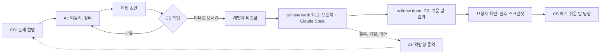

# 방향 전환: AI 가 고치는 도구에서 AI 가 통역하는 티켓 도구로

상태: 확정 (2026-10-30). 기획은 [ticket-plan.md](ticket-plan.md) v3, 결정별 근거는 [decisions.md](decisions.md)

## 한 줄 요약

지금 willnew 는 "CS 가 맡기면 AI 가 고치고 개발자는 승인만 한다" 이다. 바꾸려는 구조는 "CS 와 AI 가 대화해 문제를 정리하고, CS 가 확인한 티켓을 개발자가 받아 자기 터미널에서 푼다" 이다. AI 는 고치는 사람이 아니라 사람 사이의 통역사, 중간 관리자 역할을 맡는다.

## 왜 바꾸는가

### 1. 진짜 병목은 코드가 아니라 번역이다

CS, 디자이너, 개발자 사이에서 시간이 새는 곳은 "고치는 시간" 보다 "무엇을 고칠지 맞추는 시간" 이다.

- CS 는 고객 말을 그대로 옮긴다: "결제가 안 돼요"
- 개발자는 재현 단계, 환경, 기대 결과가 필요하다
- 그 사이를 메우려고 슬랙 왕복, 회의, "어떤 화면이요?" 가 반복된다

AI 가 코드를 대신 고쳐도 입력이 모호하면 결과도 모호하다(garbage in, garbage out). 지금 구조에서 질문 3개로 끝나는 되묻기는 이 번역 문제를 절반만 푼다. 번역 자체를 제품의 중심에 두는 편이 원래 문제에 더 직접적으로 닿는다.

### 2. LLM 이 잘하는 일에 LLM 을 쓴다

| 일 | LLM 이 잘하나 | 틀렸을 때 비용 |
|---|---|---|
| 흩어진 말을 구조로 정리, 빠진 정보 되묻기 | 잘한다 | 낮다. CS 가 확인 단계에서 바로 잡는다 |
| 개발 용어를 쉬운 말로, 쉬운 말을 개발 용어로 | 잘한다 | 낮다. 원문이 같이 붙는다 |
| 모호한 요구로 코드를 끝까지 맞게 고치기 | 들쭉날쭉하다 | 높다. 리뷰 비용, 신뢰 하락 |

틀려도 싸고 사람이 바로 고칠 수 있는 자리에 AI 를 둔다. 틀리면 비싼 자리(코드 변경과 병합)는 사람이 책임진다.

### 3. 책임과 주도권이 사람에게 남는다

- "승인만 하는 개발자" 는 남이 쓴 diff 를 리뷰하는 사람이 된다. 리뷰는 직접 쓰는 것보다 지루하고 놓치기 쉽다
- 개발자가 티켓을 받아 직접 풀면 변경의 주인이 분명하다. Claude Code 와 같이 풀든 혼자 풀든 개발자가 고른다
- 개발자 입장에서 도입 저항이 낮다. "내 일을 뺏는 도구" 가 아니라 "내게 오는 요청을 깨끗하게 만들어 주는 도구" 다

### 4. 구조가 단순해지고 약관 위험이 줄어든다

- 지금 구조는 팀 서버가 에이전트를 대신 돌리므로 허브와 러너, held 상태, 구독 계정 러너 제한 같은 장치가 필요했다. 개인 구독 계정을 팀 공용 서버에서 돌리는 건 약관 위반 소지도 있다
- 바꾼 구조에서 코드 작업은 개발자가 자기 PC, 자기 계정으로 한다. 평범한 개인 사용이다
- 팀 서버에서 도는 AI 는 CS 대화와 정리만 한다. 회사 API 키로 작은 모델(Haiku)을 쓰면 되고 비용이 작다

### 5. 만든 것을 버리지 않는다

되묻기(`triage.ts`), 작업 명세(`brief.ts`, `spec-check.ts`), 역할별 본문(`handoff.ts`), 결정 기록, 요청자 확인과 전후 스크린샷(`shots.ts`, `visual.ts`), 사람과 권한, Slack 연동은 그대로 쓴다. 바뀌는 건 "누가 고치나" 한 자리다. "AI 에게 맡기기" 는 개발자가 고르는 선택지로 남긴다.

## 바뀌는 흐름

## 추가 아이디어

현업자 지적에서 출발해 더 체계적으로 정리한 버전은 [critiques-and-ideas.md](critiques-and-ideas.md) 에 있다.

우선순위는 "이 프로젝트의 가설(번역 비용을 줄인다)을 얼마나 직접 증명하나" 순이다.

### 꼭 넣고 싶은 것

1. **팀 용어 사전**: CS 가 말하는 "결제창" 이 코드의 `CheckoutModal` 이고 "포인트 화면" 이 `/my/rewards` 라는 매핑을 쌓는다. 해결된 티켓에서 자동으로 후보를 뽑고 사람이 확정한다. 도메인 불일치를 직접 겨누는 기능이고, 쓸수록 똑똑해지는 해자다
2. **준비 완료 기준(Definition of Ready) 검사**: 재현 단계, 기대 결과, 실제 결과, 환경, 영향 범위가 다 있어야 "보내기" 가 켜진다. 빠진 칸은 AI 가 되묻는다. `spec-check.ts` 를 확장한다
3. **수용 기준을 테스트 뼈대로**: `willnew work` 할 때 수용 기준을 실패하는 테스트 초안으로 만들어 준다. 개발자가 다듬고, 그 테스트가 통과하면 끝. 기존 검증 관문(검증 명령 종료 코드)과 이어진다
4. **개발자에서 CS 로 되묻기 루프**: 개발자가 터미널에서 `willnew ask T-12 "재현 안 됨, 브라우저?"` 를 치면 AI 가 CS 말로 바꿔 보내고 답을 티켓에 붙인다. 회의 없이 비동기로 맞춘다
5. **`willnew done`**: 커밋과 PR 을 티켓에 잇고, diff 를 보고 CS 가 읽을 요약 초안을 쓴다. 개발자는 한 줄만 고친다
6. **MCP 서버**: 티켓을 CLI 뿐 아니라 MCP 로도 연다. 개발자의 Claude Code 가 티켓을 읽고, 상태를 바꾸고, CS 에게 질문을 보낼 수 있다

### 있으면 좋은 것

7. **중복 티켓 묶기**: 새 문의가 들어오면 비슷한 기존 티켓을 찾아 "같은 문제를 겪은 고객 3명째" 로 붙인다. 우선순위 판단 근거가 된다(결정은 사람이 한다)
8. **자동 재현 시도**: 재현 단계로 Playwright 를 돌려 스크린샷이나 실패 로그를 붙이고 "재현됨" 배지를 단다. 기존 `shots.ts` 재사용
9. **관련 파일과 담당자 추천**: 용어 사전, `git blame`, CODEOWNERS 로 "이 근처 코드, 이 사람" 을 제안한다
10. **고객 답장 초안**: 배포가 확인되면 CS 가 고객에게 보낼 답장 초안을 만든다. 통역이 고객까지 닿는다
11. **알려진 문제 모음**: 해결된 티켓과 "이번엔 안 함" 결정이 쌓여 CS 가 개발자를 부르지 않고 바로 답할 수 있게 된다
12. **디자이너 흐름**: 스크린샷 위에 상자를 그리거나 Figma 링크를 붙이면 AI 가 시각적 수용 기준으로 바꾼다. 요청자 확인의 전후 비교와 이어진다
13. **Jira, Linear 내보내기**: 자체 티켓함이 먼저, 외부 연동은 다음

### 가설을 재는 지표

이 전환이 맞았는지 숫자로 본다. 기존 `metrics.ts` 에 붙인다.

- 개발자가 티켓을 받은 뒤 CS 에게 되묻는 횟수 (줄어야 한다)
- 접수부터 개발자가 작업을 시작하기까지 시간
- 다시 열린 티켓 비율 ("이게 아닌데요")
- CS 가 초안을 고친 횟수 (AI 정리 품질)
- 요청자 확인에서 첫 번째에 "의도대로예요" 가 나온 비율

## 위험과 대응

| 위험 | 대응 |
|---|---|
| AI 가 CS 말을 잘못 정리하거나 없는 내용을 지어낸다 | CS 최종 확인이 필수. 원문 대화가 티켓에 그대로 붙는다 |
| 결국 Jira 의 아류가 된다 | 차별점은 티켓 관리가 아니라 양방향 통역, 용어 사전, 터미널 연결이다. 저장소는 나중에 Jira 로 바꿔 끼울 수 있게 둔다 |
| 개발자가 안 쓴다 | 개발자에게 오는 입력이 좋아지는 것이 이득. `willnew work` 한 줄로 브랜치와 맥락이 준비된다 |
| 대화가 길어져 CS 가 지친다 | 준비 완료 기준에 필요한 칸만 묻고, 다 차면 멈춘다 |
| 서버 AI 비용 | 정리와 통역만 하므로 작은 모델로 충분하다 |

# 방향 전환: AI 가 고치는 도구에서 AI 가 통역하는 티켓 도구로

상태: 확정 (2026-10-30). 기획은 [ticket-plan.md](ticket-plan.md) v3, 결정별 근거는 [decisions.md](decisions.md)

## 한 줄 요약

지금 willnew 는 "CS 가 맡기면 AI 가 고치고 개발자는 승인만 한다" 이다. 바꾸려는 구조는 "CS 와 AI 가 대화해 문제를 정리하고, CS 가 확인한 티켓을 개발자가 받아 자기 터미널에서 푼다" 이다. AI 는 고치는 사람이 아니라 사람 사이의 통역사, 중간 관리자 역할을 맡는다.

## 왜 바꾸는가

### 1. 진짜 병목은 코드가 아니라 번역이다

CS, 디자이너, 개발자 사이에서 시간이 새는 곳은 "고치는 시간" 보다 "무엇을 고칠지 맞추는 시간" 이다.

- CS 는 고객 말을 그대로 옮긴다: "결제가 안 돼요"
- 개발자는 재현 단계, 환경, 기대 결과가 필요하다
- 그 사이를 메우려고 슬랙 왕복, 회의, "어떤 화면이요?" 가 반복된다

AI 가 코드를 대신 고쳐도 입력이 모호하면 결과도 모호하다(garbage in, garbage out). 지금 구조에서 질문 3개로 끝나는 되묻기는 이 번역 문제를 절반만 푼다. 번역 자체를 제품의 중심에 두는 편이 원래 문제에 더 직접적으로 닿는다.

### 2. LLM 이 잘하는 일에 LLM 을 쓴다

| 일 | LLM 이 잘하나 | 틀렸을 때 비용 |
|---|---|---|
| 흩어진 말을 구조로 정리, 빠진 정보 되묻기 | 잘한다 | 낮다. CS 가 확인 단계에서 바로 잡는다 |
| 개발 용어를 쉬운 말로, 쉬운 말을 개발 용어로 | 잘한다 | 낮다. 원문이 같이 붙는다 |
| 모호한 요구로 코드를 끝까지 맞게 고치기 | 들쭉날쭉하다 | 높다. 리뷰 비용, 신뢰 하락 |

틀려도 싸고 사람이 바로 고칠 수 있는 자리에 AI 를 둔다. 틀리면 비싼 자리(코드 변경과 병합)는 사람이 책임진다.

### 3. 책임과 주도권이 사람에게 남는다

- "승인만 하는 개발자" 는 남이 쓴 diff 를 리뷰하는 사람이 된다. 리뷰는 직접 쓰는 것보다 지루하고 놓치기 쉽다
- 개발자가 티켓을 받아 직접 풀면 변경의 주인이 분명하다. Claude Code 와 같이 풀든 혼자 풀든 개발자가 고른다
- 개발자 입장에서 도입 저항이 낮다. "내 일을 뺏는 도구" 가 아니라 "내게 오는 요청을 깨끗하게 만들어 주는 도구" 다

### 4. 구조가 단순해지고 약관 위험이 줄어든다

- 지금 구조는 팀 서버가 에이전트를 대신 돌리므로 허브와 러너, held 상태, 구독 계정 러너 제한 같은 장치가 필요했다. 개인 구독 계정을 팀 공용 서버에서 돌리는 건 약관 위반 소지도 있다
- 바꾼 구조에서 코드 작업은 개발자가 자기 PC, 자기 계정으로 한다. 평범한 개인 사용이다
- 팀 서버에서 도는 AI 는 CS 대화와 정리만 한다. 회사 API 키로 작은 모델(Haiku)을 쓰면 되고 비용이 작다

### 5. 만든 것을 버리지 않는다

되묻기(`triage.ts`), 작업 명세(`brief.ts`, `spec-check.ts`), 역할별 본문(`handoff.ts`), 결정 기록, 요청자 확인과 전후 스크린샷(`shots.ts`, `visual.ts`), 사람과 권한, Slack 연동은 그대로 쓴다. 바뀌는 건 "누가 고치나" 한 자리다. "AI 에게 맡기기" 는 개발자가 고르는 선택지로 남긴다.

## 바뀌는 흐름

## 추가 아이디어

현업자 지적에서 출발해 더 체계적으로 정리한 버전은 [critiques-and-ideas.md](critiques-and-ideas.md) 에 있다.

우선순위는 "이 프로젝트의 가설(번역 비용을 줄인다)을 얼마나 직접 증명하나" 순이다.

### 꼭 넣고 싶은 것

1. **팀 용어 사전**: CS 가 말하는 "결제창" 이 코드의 `CheckoutModal` 이고 "포인트 화면" 이 `/my/rewards` 라는 매핑을 쌓는다. 해결된 티켓에서 자동으로 후보를 뽑고 사람이 확정한다. 도메인 불일치를 직접 겨누는 기능이고, 쓸수록 똑똑해지는 해자다
2. **준비 완료 기준(Definition of Ready) 검사**: 재현 단계, 기대 결과, 실제 결과, 환경, 영향 범위가 다 있어야 "보내기" 가 켜진다. 빠진 칸은 AI 가 되묻는다. `spec-check.ts` 를 확장한다
3. **수용 기준을 테스트 뼈대로**: `willnew work` 할 때 수용 기준을 실패하는 테스트 초안으로 만들어 준다. 개발자가 다듬고, 그 테스트가 통과하면 끝. 기존 검증 관문(검증 명령 종료 코드)과 이어진다
4. **개발자에서 CS 로 되묻기 루프**: 개발자가 터미널에서 `willnew ask T-12 "재현 안 됨, 브라우저?"` 를 치면 AI 가 CS 말로 바꿔 보내고 답을 티켓에 붙인다. 회의 없이 비동기로 맞춘다
5. **`willnew done`**: 커밋과 PR 을 티켓에 잇고, diff 를 보고 CS 가 읽을 요약 초안을 쓴다. 개발자는 한 줄만 고친다
6. **MCP 서버**: 티켓을 CLI 뿐 아니라 MCP 로도 연다. 개발자의 Claude Code 가 티켓을 읽고, 상태를 바꾸고, CS 에게 질문을 보낼 수 있다

### 있으면 좋은 것

7. **중복 티켓 묶기**: 새 문의가 들어오면 비슷한 기존 티켓을 찾아 "같은 문제를 겪은 고객 3명째" 로 붙인다. 우선순위 판단 근거가 된다(결정은 사람이 한다)
8. **자동 재현 시도**: 재현 단계로 Playwright 를 돌려 스크린샷이나 실패 로그를 붙이고 "재현됨" 배지를 단다. 기존 `shots.ts` 재사용
9. **관련 파일과 담당자 추천**: 용어 사전, `git blame`, CODEOWNERS 로 "이 근처 코드, 이 사람" 을 제안한다
10. **고객 답장 초안**: 배포가 확인되면 CS 가 고객에게 보낼 답장 초안을 만든다. 통역이 고객까지 닿는다
11. **알려진 문제 모음**: 해결된 티켓과 "이번엔 안 함" 결정이 쌓여 CS 가 개발자를 부르지 않고 바로 답할 수 있게 된다
12. **디자이너 흐름**: 스크린샷 위에 상자를 그리거나 Figma 링크를 붙이면 AI 가 시각적 수용 기준으로 바꾼다. 요청자 확인의 전후 비교와 이어진다
13. **Jira, Linear 내보내기**: 자체 티켓함이 먼저, 외부 연동은 다음

### 가설을 재는 지표

이 전환이 맞았는지 숫자로 본다. 기존 `metrics.ts` 에 붙인다.

- 개발자가 티켓을 받은 뒤 CS 에게 되묻는 횟수 (줄어야 한다)
- 접수부터 개발자가 작업을 시작하기까지 시간
- 다시 열린 티켓 비율 ("이게 아닌데요")
- CS 가 초안을 고친 횟수 (AI 정리 품질)
- 요청자 확인에서 첫 번째에 "의도대로예요" 가 나온 비율

## 위험과 대응

| 위험 | 대응 |
|---|---|
| AI 가 CS 말을 잘못 정리하거나 없는 내용을 지어낸다 | CS 최종 확인이 필수. 원문 대화가 티켓에 그대로 붙는다 |
| 결국 Jira 의 아류가 된다 | 차별점은 티켓 관리가 아니라 양방향 통역, 용어 사전, 터미널 연결이다. 저장소는 나중에 Jira 로 바꿔 끼울 수 있게 둔다 |
| 개발자가 안 쓴다 | 개발자에게 오는 입력이 좋아지는 것이 이득. `willnew work` 한 줄로 브랜치와 맥락이 준비된다 |
| 대화가 길어져 CS 가 지친다 | 준비 완료 기준에 필요한 칸만 묻고, 다 차면 멈춘다 |
| 서버 AI 비용 | 정리와 통역만 하므로 작은 모델로 충분하다 |

## 자주 받는 질문

결정별 근거와 근거 등급(확인, 2차, 가설)은 [decisions.md](decisions.md) 에 있다.

**Q. 왜 처음엔 AI 가 고치는 구조였고, 왜 바꿨나?**
처음 가설은 "개발자 손이 병목" 이었다. 만들어 보니 AI 결과를 리뷰하는 비용과, 입력이 모호해서 생기는 재시도가 더 컸다. 병목은 손이 아니라 사람 사이 번역이었다. 그래서 AI 를 틀려도 싸고 사람이 바로 고칠 수 있는 자리로 옮겼다.

**Q. AI 가 다 고치면 더 효율적이지 않나?**
쉬운 수정은 그렇다. 그래서 "AI 에게 맡기기" 를 선택지로 남겼다. 하지만 모호한 요구, 제품 판단이 필요한 요구에선 AI 결과의 품질이 들쭉날쭉하고, 책임 소재가 흐려진다. 사람이 판단하고 AI 가 마찰을 줄이는 쪽이 팀에 실제로 들어가기 쉽다.

**Q. Jira 에 AI 붙이면 되는 것 아닌가?**
Jira 는 티켓 저장소다. willnew 가 푸는 건 티켓이 생기기 전(CS 대화를 개발 언어로)과 생긴 뒤(개발자 답을 CS 언어로)의 번역, 그리고 터미널까지의 연결이다. 그래서 저장소는 나중에 Jira 로 내보낼 수 있게 설계한다.

**Q. AI 가 틀리면?**
틀려도 되는 자리에 뒀다. CS 가 초안을 확인하고, 원문 대화가 같이 가고, 우선순위와 병합 같은 결정은 사람이 한다.

**Q. 성공을 어떻게 증명하나?**
위 지표. 특히 "개발자가 CS 에게 되묻는 횟수" 와 "다시 열린 티켓 비율" 이 줄면 가설이 맞은 것이다.

**Q. 기술적으로 뭐가 단순해졌나?**
팀 서버가 에이전트를 대신 돌리지 않으니 허브와 러너 분리, held 상태, 구독 러너 제한이 필요 없어졌다. 서버는 대화와 티켓만, 코드 실행은 개발자 PC 에서 한다. 개인 구독 계정을 공용 서버에서 돌리는 약관 위험도 사라진다.

## 순서

1. 이 문서 확정
2. 티켓 모델과 티켓함(웹), CS 대화에서 초안까지, CS 확인
3. `willnew work`, `willnew ask`, `willnew done`
4. 역방향 통역과 요청자 확인 연결
5. 설치본과 zip, 두 컴퓨터에서 검증
6. 용어 사전, 지표, MCP
## 순서

1. 이 문서 확정
2. 티켓 모델과 티켓함(웹), CS 대화에서 초안까지, CS 확인
3. `willnew work`, `willnew ask`, `willnew done`
4. 역방향 통역과 요청자 확인 연결
5. 설치본과 zip, 두 컴퓨터에서 검증
6. 용어 사전, 지표, MCP
